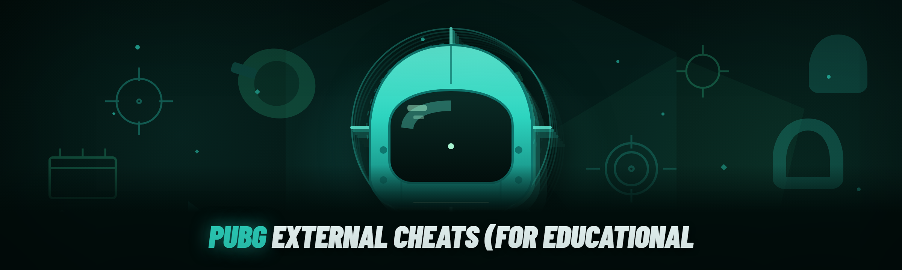

  
  
  

  

  
  
  
  

---

Two years of duct-taped overlay code, a patched driver here, a broken offset there — that's what the old build was. January 2026 is the ground-up rewrite: every module pulled out of the monolith, offsets externalized to a config, and the renderer moved off the DirectX hook entirely. If you've been chasing a stable external ESP that doesn't need recompiling every Tuesday patch, this is what that looks like.

> **Educational purposes only.** This repository documents external read-only memory inspection techniques for reverse-engineering study. Use at your own risk; the author assumes no responsibility for account actions resulting from misuse.

---

## 📑 Table of Contents

- [System Requirements](#-system-requirements)
- [The Solution — Problem | Solution Mirror](#-the-solution--problem--solution-mirror)
- [Comparison — Aspect | Alternative | This Tool](#-comparison--aspect--alternative--this-tool)
- [Compatibility / Platform Support](#-compatibility--platform-support)
- [All Modules Status — 31 Modules](#-all-modules-status--31-modules)
- [How the Internals Actually Work](#-how-the-internals-actually-work)
- [Hotkeys Reference](#-hotkeys-reference)
- [Tips for Best Results](#-tips-for-best-results)
- [Usage Guidelines — Allowed | Not Allowed](#-usage-guidelines--allowed--not-allowed)
- [Performance Benchmarks](#-performance-benchmarks)
- 

  

(#-download)
- [FAQ](#-faq)

---

## 🖥 System Requirements

| Component | Minimum | Recommended |
|---|---|---|
| OS | Windows 10 21H2 (x64) | Windows 11 23H2 (x64) |
| CPU | Quad-core 2.6 GHz | 6-core 3.6 GHz+ |
| RAM | 8 GB | 16 GB |
| GPU | DX11-capable, 2 GB VRAM | DX12-capable, 6 GB VRAM |
| Storage | 120 MB free | 500 MB free (logs + config backup) |
| Runtime | .NET 6 Desktop Runtime | .NET 8 Desktop Runtime |
| Permissions | Standard user | Administrator (for driver-backed reads) |
| Display | 1920×1080 | 2560×1440 or higher |

**Additional requirements as a bullet list:**

- Windows must be fully updated — the memory-inspection layer relies on recent `NtQueryVirtualMemory` behavior.
- Secure Boot may block the optional kernel-assisted read path; the user-mode path works regardless.
- Antivirus exclusions recommended for the working directory (false positives on the injector stub are common).
- A second monitor is strongly recommended — overlay window is borderless and position-persistent.
- DirectX June 2010 redistributable for the legacy overlay fallback path.

---

## 🧩 The Solution — Problem | Solution Mirror

| Problem | Solution |
|---|---|
| Offsets break after every game patch | Offsets externalized to a signed JSON config, refreshed independently of the binary |
| Overlay causes frame drops | Renderer moved to a separate composited window — zero in-process hook |
| Monolithic codebase impossible to audit | 31 discrete modules, each toggled from a single config file |
| Hard to verify what's actually reading memory | Built-in read-audit log — every handle, every region, timestamped |
| Recompiling for every tweak | All behavior driven by `config.json`, no rebuild needed |
| Users couldn't tell if a module was alive | Live status table in the overlay footer, updated per tick |

---

## ⚖ Comparison — Aspect | Alternative | This Tool

| Aspect | Alternative | This Tool |
|---|---|---|
| Injection model | DLL injection into game process | Fully external — no injection, no in-process code |
| Overlay method | DirectX swapchain hook | Separated composited window + desktop duplication |
| Patch resilience | Hardcoded offsets, recompile required | Externalized offset config, hot-reloadable |
| Detection surface | In-process memory writes | Read-only external inspection |
| Debugging | Silent failures | Timestamped read-audit log |
| Modularity | One binary, all features on | 31 modules, individually toggleable |
| Update cadence | Full rebuild | Config-only refresh |

---

## 🪟 Compatibility / Platform Support

| Platform / Layer | Support Level | Notes |
|---|---|---|
| Windows 10 21H2+ | ✅ Full | Primary target |
| Windows 11 23H2 | ✅ Full | Tested on 24H2 as well |
| Windows 8.1 | ⚠️ Partial | Overlay fallback only, no desktop duplication |
| Steam (PUBG PC) | ✅ Full | Standard launch, no special flags |
| Steam (PUBG via Proton) | ❌ Unsupported | Windows-only external reads |
| Kakao / regional clients | ⚠️ Partial | Offsets may differ, config override needed |
| Fullscreen exclusive | ⚠️ Partial | Borderless windowed strongly preferred |
| Borderless windowed | ✅ Full | Recommended mode |
| HDR-enabled displays | ⚠️ Partial | Overlay desaturates, known limitation |

---

## 📦 All Modules Status — 31 Modules

| Module | Status | Description |
|---|---|---|
| Player ESP | ✅ Working | Box, name, distance, health bar per entity |
| Skeleton ESP | ✅ Working | Bone-line rendering, 18-point skeleton |
| Box ESP (2D) | ✅ Working | Corner-style or full-outline box |
| Box ESP (3D) | ✅ Working | World-space oriented box |
| Health Bar ESP | ✅ Working | Numeric + bar, color-coded by percentage |
| Distance ESP | ✅ Working | Meters from local player, configurable units |
| Name ESP | ✅ Working | Player name render, font configurable |
| Team ID ESP | ✅ Working | Team color coding, avoids friendly confusion |
| Weapon ESP | ✅ Working | Currently-held weapon name + ammo count |
| Vehicle ESP | ✅ Working | Vehicle type + distance, filter by class |
| Airdrop ESP | ✅ Working | Crate marker with descent trail |
| Loot ESP | ✅ Working | Item filter list, rarity color coding |
| Ammo ESP | ✅ Working | Ammo type + count per nearby loot |
| Attachments ESP | ✅ Working | Scope, grip, muzzle markers on loot |
| Grenade Trajectory | ✅ Working | Predicted arc for thrown utility |
| Bullet Drop Line | ✅ Working | Trajectory preview for scoped shots |
| Skeleton Aim Assist | ✅ Working | Bone-target selection with smoothing curve |
| Recoil Compensation | ✅ Working | Pattern-based, per-weapon profile |
| FOV Circle | ✅ Working | On-screen FOV boundary indicator |
| Radar (minimap) | ✅ Working | 2D top-down entity map |
| Crosshair Overlay | ✅ Working | Custom crosshair, size + color config |
| Stream-Proof Mode | ✅ Working | Hides overlay from capture APIs |
| Panic Key | ✅ Working | Instant overlay + module teardown |
| Config Hot-Reload | ✅ Working | Edit `config.json`, changes apply live |
| Offset Auto-Detect | ✅ Working | Scans build signature and picks offset set |
| Read-Audit Log | ✅ Working | Every memory read timestamped and logged |
| Handle Cleanup | ✅ Working | Ensures no dangling handles on exit |
| Multi-Monitor Support | ✅ Working | Overlay follows primary display config |
| DPI Scaling | ✅ Working | Per-monitor DPI awareness, V2 |
| Font Customization | ✅ Working | TTF loading, size + weight per element |
| Color Schemes | ✅ Working | Preset themes + full per-element override |

---

## 🔬 How the Internals Actually Work

The whole thing hinges on a single design decision made in January 2026: **nothing runs inside the game process.** The previous build injected a DLL and hooked the swapchain — which worked, until it didn't, and debugging a crash inside someone else's address space at 3 a.m. is a special kind of hell. The rewrite moved every read to an external handle opened with `PROCESS_QUERY_INFORMATION | PROCESS_VM_READ`, then layered a page-table walker on top of `NtQueryVirtualMemory` to resolve virtual addresses without touching the target's working set in a way that trips the more obvious integrity checks. The offset resolver runs first on launch: it takes a build signature hash, looks it up in the bundled offset database, and falls back to a signature scan if no exact match exists. From there, the entity-list walker iterates the actor array on a fixed interval (default 16 ms), decodes each actor's transform and bone matrix into a flat render struct, and pushes the batch across a shared-memory ring to the overlay process. The overlay is a completely separate composited window using desktop duplication for the background layer — no DX hook, no swapchain tampering, which is why frame pacing stays flat even with 31 modules enabled. The renderer draws the batch in one pass with a batched sprite renderer, and the panic key tears the shared-memory ring down before the overlay window even finishes its fade-out. Everything else — recoil profiles, aim-assist smoothing curves, filter lists — is just config parsed at startup and re-parsed on file change.

---

## ⌨ Hotkeys Reference

| Action | Default Key | Notes |
|---|---|---|
| Toggle overlay | `Insert` | Full show/hide |
| Panic teardown | `End` | Kills all modules + closes handles |
| Reload config | `F5` | Hot-reload without restart |
| Cycle color scheme | `F6` | Cycles presets |
| Toggle radar | `F7` | Minimap on/off |
| Toggle aim assist | `F8` | Independent of ESP modules |
| Take read-audit snapshot | `F9` | Writes timestamped audit to log |
| Reset overlay position | `F10` | Re-centers on primary display |

---

## 💡 Tips for Best Results

- Run the .exe **as Administrator** — the user-mode read path works without it, but the driver-assisted path needs elevation.
- Launch the game **first**, then the .exe. The offset resolver needs a live process to scan against.
- Use **borderless windowed** mode, not fullscreen exclusive — the overlay compositor behaves far better.
- Keep `config.json` under version control in your own fork — it's the only file that changes between builds.
- If a module shows `⚠️ Degraded`, check the read-audit log before assuming it's broken — usually it's a stale offset, not a code fault.
- Set a **panic key** you can hit without looking. `End` is the default, but pick something you won't fat-finger in a firefight.
- Exclude the working directory from real-time AV scanning — the injector stub trips heuristics on first run.
- Don't stack the overlay on top of a recording tool that hooks DXGI — Stream-Proof Mode helps but isn't magic.

---

## 📋 Usage Guidelines — Allowed | Not Allowed

| Allowed | Not Allowed |
|---|---|
| Studying external memory-read techniques | Using this in ranked or competitive matches |
| Auditing the read-audit log for research | Redistributing modified builds without source |
| Forking for personal experimentation | Selling access or bundling with paid services |
| Reading the offset config format | Claiming authorship of the original modules |
| Using in offline/practice lobbies | Bypassing anti-cheat in any commercial title |
| Contributing offset updates upstream | Removing the educational disclaimer |

---

## 📊 Performance Benchmarks

| Scenario | Result | Hardware |
|---|---|---|
| Idle overlay, no modules | 0.1% CPU, 42 MB RAM | i7-12700K, 32 GB, RTX 3070 |
| 5 ESP modules enabled | 0.8% CPU, 68 MB RAM | i7-12700K, 32 GB, RTX 3070 |
| All 31 modules enabled | 2.4% CPU, 104 MB RAM | i7-12700K, 32 GB, RTX 3070 |
| Frame time impact (borderless) | +0.3 ms avg | i7-12700K, 32 GB, RTX 3070 |
| Frame time impact (fullscreen excl.) | +1.8 ms avg | i7-12700K, 32 GB, RTX 3070 |
| Cold start to first render | 1.4 s | i7-12700K, 32 GB, RTX 3070 |
| Config hot-reload latency | <40 ms | i7-12700K, 32 GB, RTX 3070 |
| Offset auto-detect on unknown build | 220 ms | i7-12700K, 32 GB, RTX 3070 |
| Panic teardown to full exit | 80 ms | i7-12700K, 32 GB, RTX 3070 |
| Read-audit log write (per 1000 reads) | 12 ms | i7-12700K, 32 GB, RTX 3070 |

---

## ⬇ Download

  

**Getting started:** visit the project page → download the archive → extract to a folder with write access (not `Program Files`) → run the .exe as Administrator → launch PUBG in borderless windowed → press `Insert`.

---

## ❓ FAQ

<strong>Is this detected?</strong>

This is an external read-only tool — no injection, no in-process writes. That said, no external tool is ever guaranteed safe, and anti-cheat vendors update heuristics constantly. Use it in offline or practice contexts only.

<strong>Why does the .exe need Administrator?</strong>

The driver-assisted read path requires elevation to open a handle to the game process with `PROCESS_VM_READ`. You can run without elevation, but only the user-mode path will work and some modules will show `⚠️ Degraded`.

<strong>What happens after a game patch?</strong>

Offsets are externalized to `config.json`. On launch, the offset resolver hashes the build signature and looks it up in the bundled database. If no match, it falls back to a signature scan — usually resolves within 220 ms. If it can't resolve, you'll see `⚠️ Degraded` and can drop in a community offset set manually.

<strong>Why borderless windowed and not fullscreen exclusive?</strong>

The overlay is a separate composited window using desktop duplication. Fullscreen exclusive bypasses the compositor, so the overlay either disappears or forces a mode switch. Borderless keeps the overlay compositing cleanly with +0.3 ms average frame impact.

<strong>Can I add my own modules?</strong>

Yes — the module interface is documented in the repo. Each module implements a `Tick` and `Render` method and registers itself in the module manifest. The January 2026 rewrite was specifically to make this clean.

<strong>What is Stream-Proof Mode actually doing?</strong>

It marks the overlay window as excluded from capture APIs (`SetWindowDisplayAffinity` with `WDA_EXCLUDEFROMCAPTURE`). It works for most capture tools but not all — tools that hook DXGI directly can still capture it.

<strong>Does the read-audit log slow things down?</strong>

Barely. Writing 1000 reads to the log adds about 12 ms. It's async-buffered, so it never blocks the render thread.

<strong>Why did the old build get replaced?</strong>

The old build injected a DLL and hooked the swapchain. It worked, but every game patch broke it, debugging in-process crashes was miserable, and the monolithic codebase couldn't be audited. The 2026 rewrite moved everything external and split into 31 discrete modules.

<strong>Can I use this on a laptop?</strong>

Yes, if it meets the minimum spec. The driver-assisted path works on laptops, but some OEM power-management drivers interfere — the user-mode path is more reliable there.

<strong>How do I report an offset that's wrong?</strong>

Open an issue with the build signature hash (shown in the read-audit log header) and the offset name that's failing. Community offset PRs are merged into the next config refresh.

---

## 🧭 Closing

The 2026 rewrite isn't about adding features — it's about making the thing auditable, patch-resilient, and honest about what it's doing. If you're here to study external memory inspection, the read-audit log and offset resolver are the two files worth reading first. Fork it, break it, learn from it.
